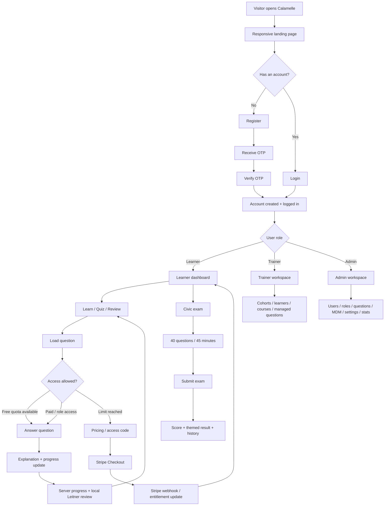

# Calamelle — Project Overview

Calamelle is a full-stack learning platform for French language, French culture, citizenship knowledge and civic-exam preparation. This file is the single source of project documentation for the current build.

## 1. Current project state

The project currently includes:

- A Figma-based Calamelle landing page implemented in React.
- Full-width desktop rendering that scales from the original 1440 px design to the browser width without empty side margins.
- Responsive mobile/tablet landing layouts for narrow screens.
- Calamelle brand colors aligned with the Figma design: deep burgundy, terracotta, warm gold and cream/paper backgrounds.
- Optimized WebP landing images and lightweight reveal/hover/floating animations.
- React learner application with authentication and role-based routing.
- Node.js / Express API.
- SQLite persistence with no external database server required.
- Local IndexedDB learner progress support with Dexie.
- Complete Calamelle QCM source bank packaged in the repository.
- French language learning, spaced repetition, reviews and progress tracking.
- Civic mock-exam workflow.
- Learner, trainer and admin roles.
- Trainer cohorts and course management.
- Admin question, user, role, MDM and settings management.
- Brevo SMTP e-mail verification and password-reset support.
- Stripe Checkout / billing portal integration and server-side entitlement enforcement.
- PWA manifest and service worker.
- Windows helper scripts for local startup, Brevo and Stripe setup.

## 2. Technology stack

### Frontend

- React 19
- React Router
- Vite 7
- CSS / CSS Modules
- Dexie / IndexedDB for local learner progress
- Lucide React icons where used in the authenticated application

### Backend

- Node.js 22.12+
- Express 5
- SQLite
- JWT authentication
- bcryptjs password hashing
- Helmet and CORS
- Brevo SMTP for OTP / account e-mail flows
- Stripe REST API for paid plans

## 3. Main folders

```text
Calamelle/
├── frontend/
│   ├── public/
│   │   └── assets/landing/        # Optimized landing-page assets
│   └── src/
│       ├── components/            # Shared application UI
│       ├── context/               # Authentication context
│       ├── lib/                   # API, local DB, shared helpers
│       └── pages/                 # Landing + learner/trainer/admin pages
├── backend/
│   ├── data/
│   │   ├── Calamelle_QCM_2741_FLAT.json
│   │   └── calamelle.db
│   └── src/                       # API, auth, access, DB, Stripe, e-mail
├── sample-data/                   # Example import data
├── scripts/                       # Local development helpers
├── .env.example                   # Main environment template
└── README.md                      # This single project document
```

## 4. Frontend routes

### Public

- `/` — responsive Calamelle landing page
- `/login` — sign in
- `/register` — registration + OTP verification
- `/forgot-password` — password-reset request
- `/reset-password` — password reset

### Authenticated learner area

- `/app` — role-aware home / dashboard
- `/app/learn` — learning questions
- `/app/quiz` — category quiz
- `/app/review` — spaced-repetition review
- `/app/civic-exam` — civic exam
- `/app/journey` — guided journey (access-gated)
- `/app/speed` — speed challenge (access-gated)
- `/app/compendium` — searchable compendium (access-gated)
- `/app/progress` — learner progress
- `/app/pricing` — plans / access
- `/app/profile` — profile and e-mail management
- `/app/courses` — assigned courses

### Trainer / admin

- `/app/trainer/*` — trainer workflows
- `/app/admin/*` — admin workflows

## 5. Roles

### Learner

Can learn, review, take quizzes/exams, view progress, use assigned courses and purchase/redeem access.

### Trainer

Has learner capabilities plus trainer management access for cohorts, learners, courses and managed question content.

### Admin

Has full management access, including users, roles/status, questions, MDM values, app settings and trainer-level workflows.

## 6. Learning and access rules

### Free learner

- Up to **20 new general-learning questions per Europe/Paris calendar day**.
- Previously unlocked/studied questions can be reviewed without consuming another daily allowance.
- One free civic mock allowance is enforced server-side.

### Monthly / Annual / Lifetime

- Full learning access while the entitlement is active.
- Lifetime has no expiry.

### Pass Naturalisation

- Time-limited Naturalisation/civic access.
- Unlimited civic questions and related civic features while active.
- General-learning questions still follow the free daily rule unless the user also has full access.

### Role access

Trainer and admin roles retain management access required by their roles.

## 7. Learning engine

Calamelle combines server progress with a local spaced-repetition model.

The local browser database uses a five-box Leitner-style progression with review intervals approximately:

```text
Box 1 → 1 day
Box 2 → 3 days
Box 3 → 7 days
Box 4 → 14 days
Box 5 → 30 days
```

Correct answers move a question forward; an incorrect answer returns it to the first box. Server-side progress is also stored for authenticated users.

## 8. Civic exam

The civic-exam experience is designed around:

- 40 questions
- 45 minutes
- 80% success target
- submission and themed result analysis
- exam-history persistence

The packaged QCM source file contains **2,741 QCM**. The application database includes the learning and civic question sets used by the current build, including the 300-question civic set.

## 9. Authentication and account flow

Registration uses e-mail OTP verification before the account is created.

```text
Registration form
→ Send six-digit OTP
→ Verify OTP
→ Create account
→ Create session
→ Automatic login
```

The project also includes:

- login/logout
- current-user session lookup
- password reset
- name update
- verified e-mail-change flow
- rate limits around sensitive authentication actions

For local development without SMTP credentials, the development OTP fallback can be enabled with environment configuration.

## 10. Payments and plans

Supported plan keys in the backend:

| Plan | Backend behavior |
|---|---|
| `monthly` | Stripe subscription, full access |
| `annual` | Stripe subscription, full access |
| `naturalisation` | One-time payment, civic/Naturalisation access window |
| `lifetime` | One-time payment, full access without expiry |

The backend supports:

- Stripe Checkout session creation
- webhook signature verification
- payment/session reconciliation
- billing portal sessions
- access-code redemption
- server-side entitlement checks

Use Stripe test mode before production.

## 11. Trainer workflows

Trainer/admin APIs and UI support:

- cohort creation and editing
- adding/removing cohort members
- learner listing
- course creation/edit/delete
- adding questions to a course
- batch question assignment
- assigning courses to cohorts
- managed question creation/edit/archive/status changes

## 12. Admin workflows

Admin functionality includes:

- question CRUD and JSON import
- platform statistics
- user list and role changes
- user suspend/restore
- MDM CRUD for modules/themes/levels/question types
- application settings
- all trainer-level management functions

## 13. Main application flowchart



## 14. Backend architecture

The API is grouped around these domains:

```text
Auth
├── registration + OTP
├── login/logout/session
├── password reset
└── profile/e-mail change

Learning
├── question categories
├── daily free question queue
├── question answer validation
├── progress
└── progress import

Civic exam
├── exam configuration
├── session generation
├── submit
└── history

Access and payments
├── access summary
├── plans
├── Stripe checkout
├── billing portal
├── Stripe webhook
└── access codes

Trainer
├── cohorts
├── learners
├── courses
└── managed questions

Admin
├── questions/import
├── stats
├── users/roles/status
├── MDM
└── settings
```

## 15. Database

SQLite stores the main application state. Important tables include:

- `users`
- `auth_sessions`
- `pending_registrations`
- `questions`
- `answers`
- `progress`
- `daily_free_questions`
- `exam_sessions`
- `exam_attempts`
- `institutions`
- `cohorts`
- `cohort_members`
- `courses`
- `course_questions`
- `course_cohorts`
- `course_question_attempts`
- `course_completions`
- MDM tables
- `app_settings`
- `access_codes`
- `payments`
- `stripe_events`
- `password_reset_tokens`
- `email_change_requests`

## 16. Landing page implementation

The current landing page is in:

```text
frontend/src/pages/LandingPage.jsx
frontend/src/pages/LandingPage.module.css
```

Landing-page assets are in:

```text
frontend/public/assets/landing/
```

Current behavior:

- Desktop layout is based on the 1440 px Figma composition and scales to the full viewport width.
- Empty left/right browser margins are removed on wide screens.
- Mobile layout switches to a dedicated responsive flow at narrow widths.
- Images are WebP where appropriate to reduce transfer size.
- Scroll-reveal, hover and subtle floating animations are included.
- `prefers-reduced-motion` is respected.

## 17. Local setup

### Requirements

- Node.js **22.12+**
- npm

### Development

```bash
npm install
npm run dev
```

Default local endpoints:

```text
Frontend: http://localhost:5173
Backend:  http://localhost:4000
```

### Windows shortcut

You can also run:

```text
START_CALAMELLE.bat
```

### Production-style local run

```bash
npm run build
npm start
```

or on Windows:

```text
RUN_PRODUCTION.bat
```

## 18. Environment configuration

Copy `.env.example` and configure the values needed for your environment.

Important variables:

```text
PORT
JWT_SECRET
FRONTEND_URL
PAYMENTS_MODE
STRIPE_SECRET_KEY
STRIPE_WEBHOOK_SECRET
STRIPE_PRICE_MONTHLY
STRIPE_PRICE_ANNUAL
STRIPE_PRICE_NATURALISATION
STRIPE_PRICE_LIFETIME
SMTP_HOST
SMTP_PORT
SMTP_USER
SMTP_PASS
SMTP_SECURE
SMTP_STARTTLS
EMAIL_FROM
OTP_EXPIRY_MINUTES
OTP_RESEND_SECONDS
OTP_MAX_ATTEMPTS
OTP_MAX_RESENDS
EXPOSE_DEV_OTP
PASSWORD_RESET_MINUTES
ENABLE_DEMO_ACCESS_CODE
```

### Brevo

For real e-mail delivery, configure `SMTP_USER`, `SMTP_PASS` and a verified `EMAIL_FROM`. The Windows helper is:

```text
SETUP_BREVO_EMAIL.bat
```

Never commit or share a real SMTP/API secret.

### Stripe

Set `PAYMENTS_MODE=stripe`, then configure the Stripe secret, webhook secret and price IDs. The Windows helper is:

```text
SETUP_STRIPE.bat
```

Use `sk_test_...` and test Price IDs first.

## 19. Database reset

To recreate the local database:

```bash
npm run reset-db
```

Restart the application after the reset.

## 20. Question import

The packaged source bank is:

```text
backend/data/Calamelle_QCM_2741_FLAT.json
```

Admin question import is available through the admin area. A sample structure is available under `sample-data/`.

## 21. Development helpers

Useful project scripts include:

```text
START_CALAMELLE.bat
RUN_PRODUCTION.bat
RUN_WINDOWS_FALLBACK.bat
SETUP_BREVO_EMAIL.bat
DIAGNOSE_BREVO.bat
SETUP_STRIPE.bat
start-calamelle.sh
```

## 22. Security / production notes

Before production:

- replace the development `JWT_SECRET` with a strong random secret of at least 32 characters;
- disable development OTP exposure;
- disable the demo access code;
- use verified Brevo sender/domain settings;
- use Stripe live credentials only after test-mode validation;
- configure the Stripe webhook secret;
- do not publish `.env` secrets;
- review seeded/demo accounts before deployment.

---

This README intentionally replaces the previous version-by-version changelogs, QA reports and separate setup/architecture markdown files so the project has one current documentation source.
# Calamelle

